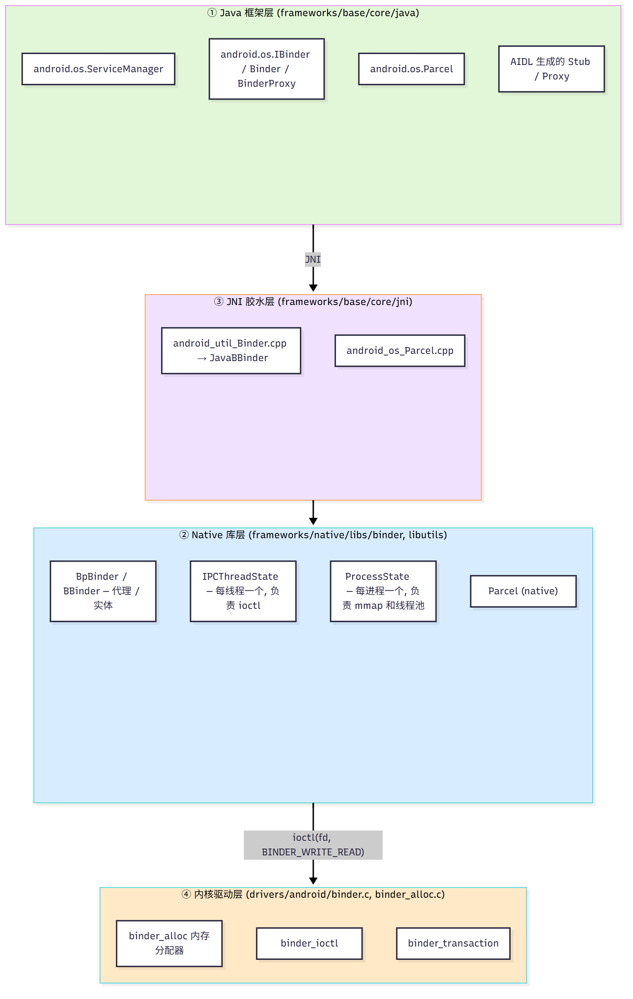
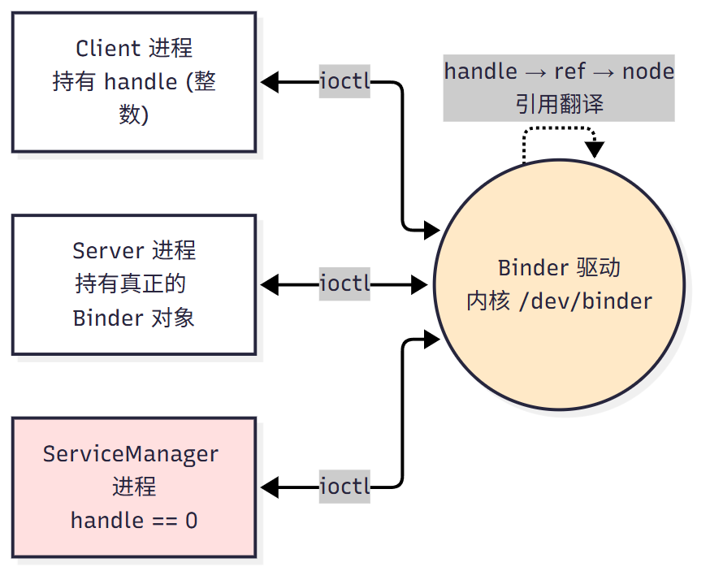
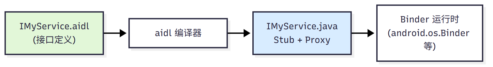
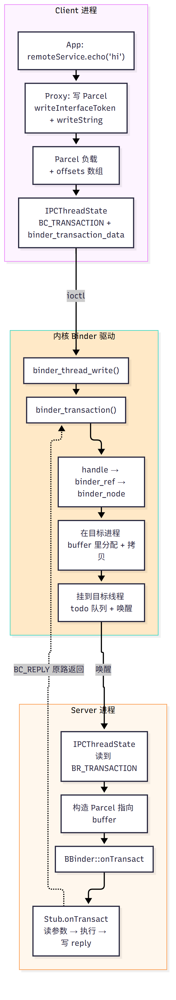

> **Android Binder 消息流转全解**
>
> [导读 消息流转全解：系列导读](/2026/11/11/00-android-binder消息流转全解/) · [01 架构总览](/2026/11/11/01-架构总览/) · [02 消息封装](/2026/11/11/02-消息封装/) · [03 RPC 原理](/2026/11/11/03-rpc原理/) · [04 内核数据结构](/2026/11/11/04-内核数据结构/) · [05 完整消息流转](/2026/11/11/05-完整消息流转/) · [06 进阶专题](/2026/11/11/06-进阶专题/) · [07 源码索引与调试](/2026/11/11/07-源码索引与调试/)

## 1. Binder 到底是个什么东西

**Binder 是 Android 独有的、面向对象的跨进程通信（IPC）机制，同时也是它的远程调用（RPC）框架。**

它和 Linux 传统 IPC 最大的区别在于：

| 传统 IPC（Socket / 管道 / 消息队列） | Binder |
|--------------------------------------|--------|
| 传的是**字节流**，谁写的谁读的要双方自己约定 | 传的是**对象引用 + 方法调用**，有类型系统（AIDL） |
| 需要两次拷贝（发送方 → 内核 → 接收方） | 只有**一次拷贝**（详见 [`04-内核数据结构.md`](/2026/11/11/04-内核数据结构/)） |
| 不知道对端是谁（谁先连上算谁的） | 内核知道每个传输的**身份**（pid/uid），天然支持权限校验 |
| 需要自己实现「谁在哪、怎么找」 | 有 `ServiceManager` 名字服务 |
| 需要自己实现线程管理和并发 | 内核负责唤醒和线程池扩充 |

Binder 的目标很直接：**让跨进程调用写起来像本地方法调用**。

```java
// 本地调用
String s = localService.echo("hi");

// 跨进程调用 —— 写法几乎一样，中间发生的事情完全不同
String s = remoteService.echo("hi");
```

---

## 2. 分层架构

Binder 是典型的「用户态协议 + 内核驱动」设计。从上到下分四层：



### 各层职责一句话

| 层 | 职责 |
|----|------|
| **Java 框架层** | 给应用提供 `IBinder`/`Parcel`/AIDL 这些 API，屏蔽 JNI 细节 |
| **JNI 胶水层** | 在 Java `Binder` 和 native `BBinder` 之间做**双向适配**（`JavaBBinder` 就是「长得像 BBinder 的 Java 对象」） |
| **Native 库层** | 实现真正的协议逻辑：打包事务、调用 `ioctl`、解析返回值、维护线程池 |
| **内核驱动层** | 做**对象引用翻译**、**内存分配**、**线程唤醒**，是 Binder 性能和安全性的关键 |

> **重要认知**：Binder 的「魔法」大部分在内核里。用户态库（`libbinder`）做的事情本质上是**用 `ioctl` 跟驱动对话**，把「方法调用」翻译成一串内核命令。

---

## 3. 四个角色

一次 Binder 通信里只有这四种参与者：



| 角色 | 关键特征 | 在哪个进程 |
|------|----------|-----------|
| **Client** | 只持有 `handle`（一个 `uint32_t`），**看不到**服务端对象的真实地址 | 任意应用进程 |
| **Server** | 持有真正的 Binder 对象（Java 里是 `android.os.Binder` 子类实例；native 里是 `BBinder`），内核为它建了 `binder_node` | 如 `system_server` |
| **ServiceManager** | 特殊：它的 `handle` 被**固定为 0**，是 Binder 的「DNS」 | `/system/bin/servicemanager` |
| **Binder 驱动** | 唯一能看到所有进程、能做引用翻译和内存拷贝的地方 | 内核 |

### 为什么必须有 ServiceManager？

因为 Client 要调用 Server，前提是**拿到 handle**。第一次拿到 handle 的过程叫「查询服务」：

```
Client: "我要用 foo 服务"  →（handle 0）→ ServiceManager
ServiceManager: "foo 的 handle 是 42"  → Client
Client: 拿着 handle=42 去调用  →（内核翻译）→ foo 服务
```

`ServiceManager` 自己的 handle 是 0，这个 0 是**内核硬编码**的（第一个调用 `BINDER_SET_CONTEXT_MGR` ioctl 的进程会成为 context manager，内核把它的 node 记在全局变量 `binder_context_mgr_node` 上）。详见 [`05-完整消息流转.md`](/2026/11/11/05-完整消息流转/) 第 5 节。

---

## 4. 三个 Binder 域（三个设备节点）

从 Android 8 开始，Binder 被拆成三个**互相隔离**的域，各自有独立的 `/dev/` 节点：

| 设备节点 | 宏 | 用途 | 谁在用 |
|----------|----|------|--------|
| `/dev/binder` | `BINDER_TYPE_BINDER` 域 | 框架层 IPC | App、`system_server`、系统服务 |
| `/dev/hwbinder` | hwbinder 域 | HIDL / AIDL over hwbinder | HAL 进程（相机、传感器…） |
| `/dev/vndbinder` | vndbinder 域 | Vendor 进程互调 | vendor 分区里的守护进程 |

**为什么要拆？** 安全和版本解耦：

- 应用进程一般只能访问 `/dev/binder`，碰不到 HAL。
- `hwbinder` 上的 `HIDL` 有自己的 ABI 版本管理，可以独立于 framework 演进。
- 三个域的 `binder_node`/`binder_ref` 是**完全独立的命名空间**，handle 不能跨域使用。

> 实现细节：Android 10 引入 **`binderfs`**（一种内核 pseudo-filesystem），可以动态创建多个 Binder 域，不再依赖固定的 `misc` 设备号。挂载点通常是 `/dev/binderfs/`。

---

## 5. 与 AIDL / HIDL / AIDL-over-vendor 的关系

**AIDL 不是 Binder 本身，它只是「帮你生成 Binder 样板代码」的编译器。**



| 名字 | 是什么 | 底层 |
|------|--------|------|
| **AIDL** | Android Interface Definition Language。写 `.aidl` 文件 → 生成 `Stub`/`Proxy` | `/dev/binder` |
| **HIDL** | Android 8~10 的 HAL 接口语言，语法类似 AIDL 但基于 C++ | `/dev/hwbinder` |
| **Stable AIDL** | Android 11+ 用 AIDL 全面替代 HIDL，支持 `@VintfStability` 和稳定版本 | `/dev/binder` 或 `/dev/hwbinder` |
| **AIDL-over-vndbinder** | vendor 进程之间的 AIDL | `/dev/vndbinder` |

**记住这个分层**：

```
AIDL 只是「代码生成器」
    ↓ 生成
Proxy / Stub（用户态样板代码）
    ↓ 调用
libbinder（IPCThreadState / BpBinder / Parcel）
    ↓ ioctl
Binder 驱动（真正的 RPC 引擎）
```

AIDL 生成的东西是**可替换**的 —— 你完全可以手写 `transact`/`onTransact`（Android 早期就是这么干的），只是在 Android 12+ 因为 `Parcel` 构造函数被标记为 `@UnsupportedAppUsage`，手写会越来越麻烦。

---

## 6. 数据流全景（先建立直觉）

下面这张图就是本目录后面所有文档要展开的东西。**先看个大概，不用抠细节**：



---

## 7. 本文档集合用到的术语约定

| 术语 | 含义 |
|------|------|
| **事务 / transaction** | 一次「调用 + 参数」，是 Binder 的传输单位 |
| **句柄 / handle** | 内核分配给某进程的 `uint32_t`，代表「对某个 Binder 对象的引用」 |
| **实体 / node** | 服务端进程里真正的 Binder 对象，内核用 `binder_node` 表示 |
| **BC_xxx** | Binder **C**ommand，用户态**写给**内核的命令 |
| **BR_xxx** | Binde**R** **R**eturn，内核**返回给**用户态的响应 |
| **代理 / Proxy** | 客户端侧代表远程对象的本地替身 |
| **桩 / Stub** | 服务端侧的骨架，负责解包参数、调用真实实现 |
| **oneway** | 单程异步调用，不等回复（`TF_ONE_WAY`） |

---

下一章：[`02-消息封装.md`](/2026/11/11/02-消息封装/) —— 搞清楚这些数据在内存里到底长什么样。

---

通过Claude生成。
